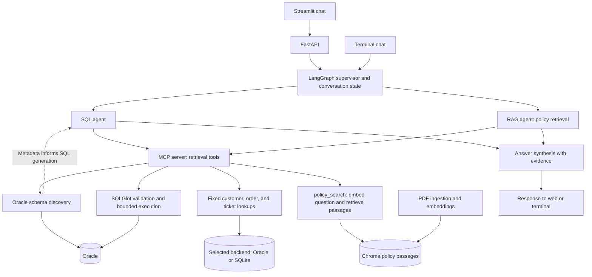

# Customer Support Multi-Agent AI

A customer support assistant that answers questions using customer records and company policy PDFs. It can look up orders and tickets, clarify ambiguous customer names, remember follow-up questions, and combine database facts with cited policy passages.

[Watch the video demo](https://drive.google.com/file/d/1nyhptz4e2ERIvjOXr5eyZKM0FoNNDflS/view?usp=drive_link)

## What is implemented

- **Conversational support:** a supervisor routes each question to the SQL agent, policy agent, or both, then synthesizes an evidence-based answer.
- **Schema-aware Oracle queries:** the SQL agent calls MCP tools to discover tables, columns, and relationships **before generating SQL**. Discovery is part of the actual answer workflow.
- **Restricted SQL execution:** generated queries pass SQLGlot validation and run through a read-only Oracle account, with bound parameters, timeouts, and result limits. The agent can refresh metadata and retry once after a repairable error.
- **Policy retrieval with citations:** uploaded PDFs are split into passages, embedded, and searched in Chroma. Answers include source/page citations.
- **Web and terminal interfaces:** Streamlit chat, a FastAPI backend, and a CLI, with automated tests and live-model evaluation.

The demo contains **25 customers, 75 orders, and 75 tickets**, plus a generated policy PDF.

## Architecture and technology



| Technology | Role |
| --- | --- |
| Python 3.13, LangGraph | Agent routing, conversation state, and workflow |
| OpenAI | Chat decisions and SQL generation (`gpt-4.1-mini`); policy embeddings (`text-embedding-3-small`) |
| MCP | Tool boundary between agents and data retrieval |
| Oracle, python-oracledb, SQLGlot | Relational data, schema discovery, and validated read-only SQL |
| SQLite | Lightweight alternative using fixed lookup tools |
| Chroma, PyMuPDF | Policy vector search and PDF text extraction |
| FastAPI, Streamlit, Docker Compose | API, chat interface, and local services |

**Choose one customer database per run.** Oracle is the full schema-aware workflow; SQLite is the simpler default in `.env.example`. Chroma is a separate policy store in either mode. There is no automatic synchronization or fallback between Oracle and SQLite. The migration command copies and verifies a SQLite snapshot into Oracle.

## MCP tools and RAG in action

**MCP (Model Context Protocol)** connects the agent workflow to a local tool server over standard input/output. The agents retrieve records, schema metadata, and policy passages through these tools:

| MCP tools | How the workflow uses them |
| --- | --- |
| `customer_lookup`, `customer_profile` | Resolve a name/email or confirmed customer ID before customer-specific retrieval; ask for clarification when multiple customers match. |
| `order_lookup`, `support_tickets` | Retrieve paginated customer records in the SQLite agent workflow. These tools are also available with Oracle. |
| `list_tables`, `search_schema` | Discover approved Oracle tables and prioritize metadata relevant to the question. Schema search uses keywords, not embeddings. |
| `describe_table`, `get_relationships` | Supply actual columns, types, constraints, indexes, and foreign-key pairs to the Oracle SQL planner before it generates a query. |
| `execute_readonly_query` | Validate and execute the generated Oracle SQL with bound values; return bounded results as answer evidence. |
| `refresh_schema_index` | Reload cached Oracle metadata before the single allowed repair attempt after a recoverable query/discovery error. |
| `policy_search` | Retrieve relevant policy text and source/page metadata from Chroma for the RAG agent. |

The schema-discovery, refresh, and generated-query tools are registered only in Oracle mode. They are called by the SQL workflow, rather than merely exposed for external clients.

**RAG (retrieval-augmented generation)** grounds answers in retrieved policy text:

1. **Ingest:** PDF upload or the ingestion CLI extracts text, creates overlapping passages, embeds them with OpenAI, and stores them with source/page metadata in Chroma. Ingestion is separate from the MCP retrieval tools.
2. **Retrieve:** the RAG agent builds a focused search query from the question and any retrieved customer evidence, then calls `policy_search`. The tool embeds the query and returns up to five passages that meet the configured relevance threshold.
3. **Answer:** synthesis combines those passages with database evidence and renders policy citations. If no relevant passage is found, the workflow reports insufficient evidence rather than deciding eligibility from records alone.

For example, **“Can Emma Wilson get a refund for her latest order?”** follows: customer resolution → Oracle schema discovery → validated order query → policy search → answer with order facts, policy citations, and any missing eligibility questions. A general policy question skips database retrieval.

## Run locally

These commands use **PowerShell**, from the repository root. You need Python **3.13**, an OpenAI API key, and Docker Desktop running for Oracle. Model calls and policy ingestion use the paid OpenAI API.

### 1. Install and configure

```powershell
py -3.13 -m venv .venv
.\.venv\Scripts\python.exe -m pip install -r requirements-lock.txt
.\.venv\Scripts\python.exe -m pip install --no-deps -e .
if (!(Test-Path .env)) { Copy-Item .env.example .env }
```

Edit `.env` locally. For the full Oracle workflow, set:

```dotenv
OPENAI_API_KEY=<your API key>
SUPPORT_DB_BACKEND=oracle
SUPPORT_ORACLE_USER=SUPPORT_READER
SUPPORT_ORACLE_SCHEMA=SUPPORT_OWNER
SUPPORT_ORACLE_DSN=127.0.0.1:1521/FREEPDB1
SUPPORT_ORACLE_ADMIN_PASSWORD=<local admin password>
SUPPORT_ORACLE_OWNER_PASSWORD=<local owner password>
SUPPORT_ORACLE_PASSWORD=<local reader password>
```

Use three distinct passwords, each 12–30 characters without double quotes or line breaks. Keep credentials in the ignored `.env` file. Other settings and defaults are in [.env.example](.env.example).

### 2. Create the demo database — first run only

```powershell
# Create the SQLite snapshot used as the migration source.
.\.venv\Scripts\python.exe -m support_ai.seed --db data/support.db

# Start Oracle and wait until it is healthy.
docker compose -f compose.yaml -f compose.oracle.yaml up -d --wait oracle

# Create the owner, schema, and restricted reader; then import the demo data.
.\.venv\Scripts\python.exe -m support_ai.oracle_setup
.\.venv\Scripts\python.exe -m support_ai.oracle_migrate --source data/support.db
```

Provisioning expects a fresh database and refuses to overwrite existing accounts. Skip `oracle_setup` after the first successful setup. Migration verifies every record; an identical rerun is unchanged, while conflicting data is rejected. Changing passwords in `.env` does not change existing database passwords.

**Prefer SQLite?** Set `SUPPORT_DB_BACKEND=sqlite`, run only the seed command above, and continue below. Docker and Oracle credentials are unnecessary. SQLite supports the same chat and policy interface through fixed record lookups; generated schema-aware SQL is Oracle-only.

### 3. Add the demo policies

```powershell
.\.venv\Scripts\python.exe -m support_ai.demo_pdfs
.\.venv\Scripts\python.exe -m support_ai.policies ingest output/pdf/demo_policies.pdf
```

You can also upload your own policy PDFs through the chat sidebar. Ingestion persists embeddings in Chroma; unchanged documents do not need to be ingested on every startup.

### 4. Start the application

In one terminal:

```powershell
.\.venv\Scripts\python.exe -m support_ai.api
```

In a second terminal, from the same repository:

```powershell
.\.venv\Scripts\python.exe -m streamlit run streamlit_app.py
```

Open **http://localhost:8501**. The API runs at **http://127.0.0.1:8000**, with interactive endpoint documentation at `/docs`.

For subsequent runs, start the Oracle container if needed and launch these two processes. Installation, provisioning, migration, and policy ingestion are setup steps, not daily startup steps. Stop the application with `Ctrl+C` in each terminal; stop Oracle without deleting its data with:

```powershell
docker compose -f compose.yaml -f compose.oracle.yaml stop oracle
```

## Try it

Ask these in one conversation:

1. “What is Emma's latest order?” — the assistant should ask which Emma.
2. “Emma Wilson.” — it should resolve the customer and retrieve her order.
3. “Does she have any open tickets?” — it should reuse the conversation context.
4. “Show her orders alongside their support tickets.” — Oracle uses discovered relationships to build the query.
5. “Can she get a refund for her latest order?” — combines records with policy evidence and asks for missing eligibility facts.
6. “What is the general refund policy?” — retrieves policy passages with citations.

Terminal alternative:

```powershell
.\.venv\Scripts\python.exe -m support_ai.chat
```

Use `/new` to reset the conversation and `/quit` to exit.

<details>
<summary>Optional: run the application in Docker too</summary>

After completing the Oracle database setup above, run:

```powershell
docker compose -f compose.yaml -f compose.oracle.yaml up --build -d api ui
```

Open **http://localhost:18501**; the API is on **http://127.0.0.1:18000**. Compose runs the migration service before starting the API and uses the reader account for application queries.

The Docker application uses its own policy storage volume. Upload `output/pdf/demo_policies.pdf` through this UI even if you already ingested it locally.

For an entirely SQLite-based container demo, set `SUPPORT_DB_BACKEND=sqlite` and use `docker compose up --build -d` instead.

Stop the stack with `docker compose -f compose.yaml -f compose.oracle.yaml down` (or `docker compose down` for SQLite). Named volumes retain data; avoid `--volumes` unless you intend to remove it.

</details>

## Verify and evaluate

Run the local automated suite; live integration tests skip without their dedicated environment:

```powershell
.\.venv\Scripts\python.exe -m pytest -q
```

Run the conversational evaluation against your configured Oracle database and ingested policies. This makes real model calls and writes a local report:

```powershell
.\.venv\Scripts\python.exe -m support_ai.evaluate --backend oracle
```

Use `--backend sqlite` for the SQLite workflow. CI also exercises Oracle integration with a dedicated database. See the [evaluation report](docs/evaluations/phase-07.md) for recorded results, issues found, and fixes. Live smoke checks demonstrate the tested scenarios; they do not establish general answer accuracy.

## Scope and limits

- Oracle access is restricted to approved tables and read-only queries. Results have row, column, text, payload, and time limits; truncated results are identified in the answer.
- Customer identity is clarified before customer-specific retrieval. Schema discovery and SQL validation constrain execution but cannot guarantee that generated SQL answers the intended question.
- This is a local demonstration: there is no authentication or per-customer authorization. Conversation state is in memory, while database records and policy embeddings persist. Uploaded policies are shared across sessions.
- The API `/health` endpoint reports application liveness/configuration; it does not prove Oracle connectivity.

Key code: [agent workflow](src/support_ai/agents.py), [Oracle SQL agent](src/support_ai/oracle_agent.py), [MCP tools](src/support_ai/mcp_server.py), [SQL validation](src/support_ai/sql_validation.py), and [query execution](src/support_ai/query_service.py).
